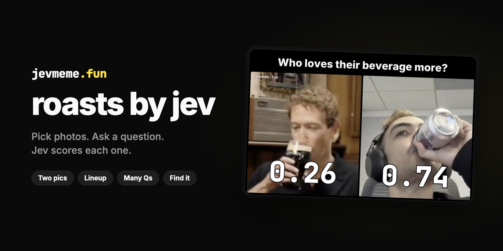

<p align="center">
  
</p>

<p align="center">
  <a href="https://jevmeme.fun"></a>
  <a href="https://typesafe.ai"></a>
  
  
  <a href="LICENSE"></a>
</p>

<p align="center">
  Pick photos, ask a question, and get a meme with Jev's real confidence on each one.
</p>

<p align="center">
  <a href="https://jevmeme.fun"><b>Make one → jevmeme.fun</b></a>
</p>

Jev is [TypeSafe AI](https://typesafe.ai)'s System One model. It answers
yes/no questions with a number from 0 to 1. This app shows it photos and
prints that number on each one. The scores are not made up.

## What it does

- **Four layouts.** *Two pics* and *Lineup* (3–4 pics) score each photo
  against one question. *Many Qs* asks up to four questions about one photo.
  *Find it* draws a box around what you name.
- **Your photos or ours.** Upload your own, or tap a bundled sample.
- **Share it.** Post to X with a link card that shows the meme. Or use your
  phone's share sheet, save the image, or copy the link.

## Run it locally

You need Node 20+, a [TypeSafe](https://typesafe.ai) API key, and a
[Vercel Blob](https://vercel.com/docs/vercel-blob) store.

```bash
npm install
cat > .env.local <<'EOF'
TYPESAFE_AI_API_KEY=...
BLOB_READ_WRITE_TOKEN=...
EOF
npm run dev
```

Open http://localhost:3000.

## How it works

1. The browser turns each uploaded photo upright and resizes it to fit
   Jev's limits (`lib/prep.ts`).
2. `POST /api/meme` sends the photos to Jev through `@typesafe-ai/sdk`
   (`lib/jev.ts`). Image inputs are experimental, so each request sends
   `TypeSafe-Danger-Zone-Images: true`
   ([docs](https://docs.typesafe.ai/images)). In *Two pics* and *Lineup*,
   each photo is scored on its own, so one cannot sway another. *Find it*
   uses a Jev 1.14 `box` question.
3. Uploads and the finished meme (as JSON) go to Vercel Blob. The meme id is
   a hash of its inputs, so the same meme is never scored twice.
4. Satori (`next/og`) draws every meme PNG in `lib/render.tsx`. The page,
   the download and the X card are the same pixels.

## Scripts

```bash
npx tsx scripts/shots.mts http://localhost:3000 shots   # iPhone screenshots of the main flows
npx tsx --env-file=.env.local scripts/gen-samples.mts    # regenerate the sample photos (AI Gateway)
node assets/brand/render.mjs                             # redraw the banner above
```

## License

MIT — see [LICENSE](LICENSE).
